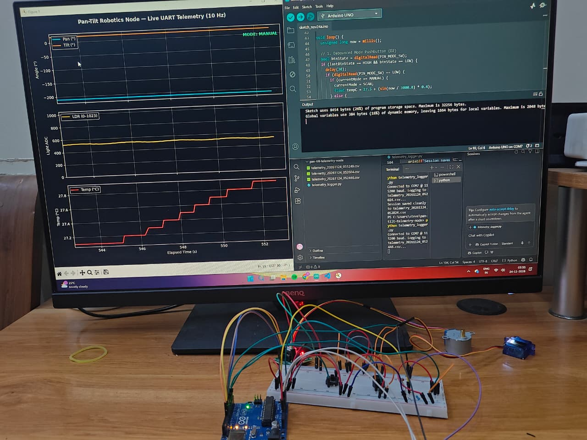

# 2-Axis Pan-Tilt Robotics & UART Telemetry Node

An embedded robotics and real-time telemetry system built on the **Arduino Uno R3** with a **Python (`pyserial` + `matplotlib`) PC ground station**. Features closed-loop optical target acquisition, a deterministic 3-state FSM (`MANUAL` → `SCAN` → `LOCKED`), and 10 Hz JSON UART streaming.




https://github.com/user-attachments/assets/b2ad74d4-8815-4290-93c3-8e1b449b1dd6


## System Architecture

```text
[PS2 Joystick (A0/A1)] ──┐
[LDR Divider (A2)] ──────┼──► [Arduino Uno R3 (16 MHz)] ──► 115200 Baud JSON UART ──► [Python Ground Station]
[Mode Button (D2)] ──────┘      │         │         │                                   ├── Live 3-Axis Plot
                                ▼         ▼         ▼                                   └── Timestamped CSV Log
                          [28BYJ-48]   [SG90]   [Active Buzzer]
                         (Pan Axis)  (Tilt Axis)  (Lock Alert)
